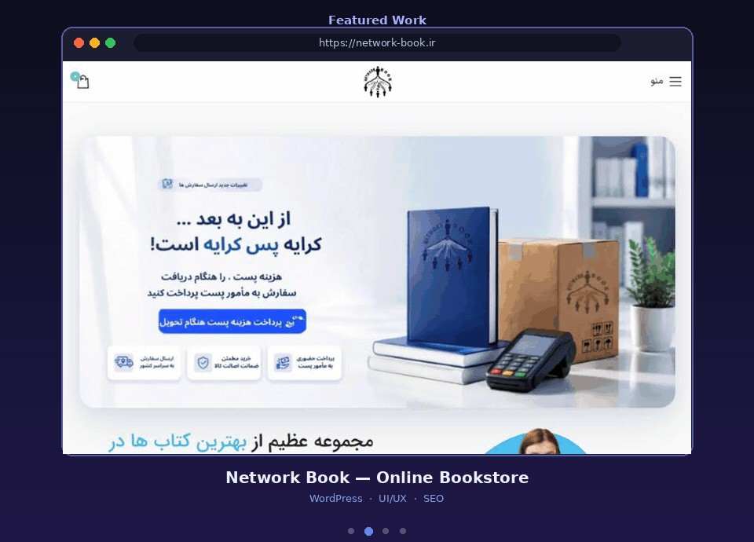

<h1 align="center">Network Book — Online Bookstore</h1>

<b>نتورک بوک</b> · <a href="https://network-book.ir">network-book.ir</a>

  

  
  
  
  

---

### 📌 About the Project

An online bookstore with a large catalog, category search and nationwide shipping.

### ✨ Features

- Product search with category filter
- Promotional hero banners
- Pay-on-delivery shipping flow
- Wishlist and shopping cart
- Mobile app-style bottom navigation
- Fully responsive layout

### 🛠 My Role

- UI/UX design and layout
- WordPress & WooCommerce development
- Performance and SEO optimization

### 🔗 Live Website

👉 **[network-book.ir](https://network-book.ir)**

---

> 🔒 This is a **showcase** repository. The source code is private for client confidentiality.
> Interested in a similar project? Contact me on Telegram: **[@fesqhli](https://t.me/fesqhli)**

Made by <a href="https://github.com/zeroux-dev">ZERO (zeroux-dev)</a>

